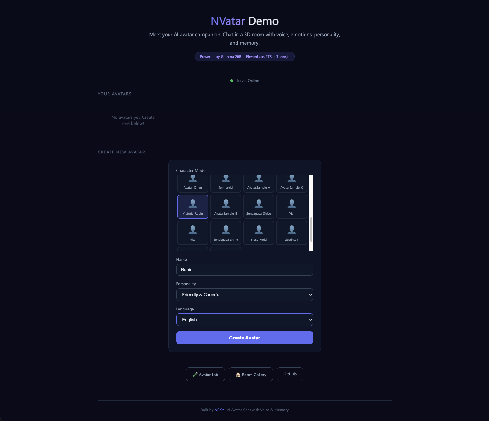
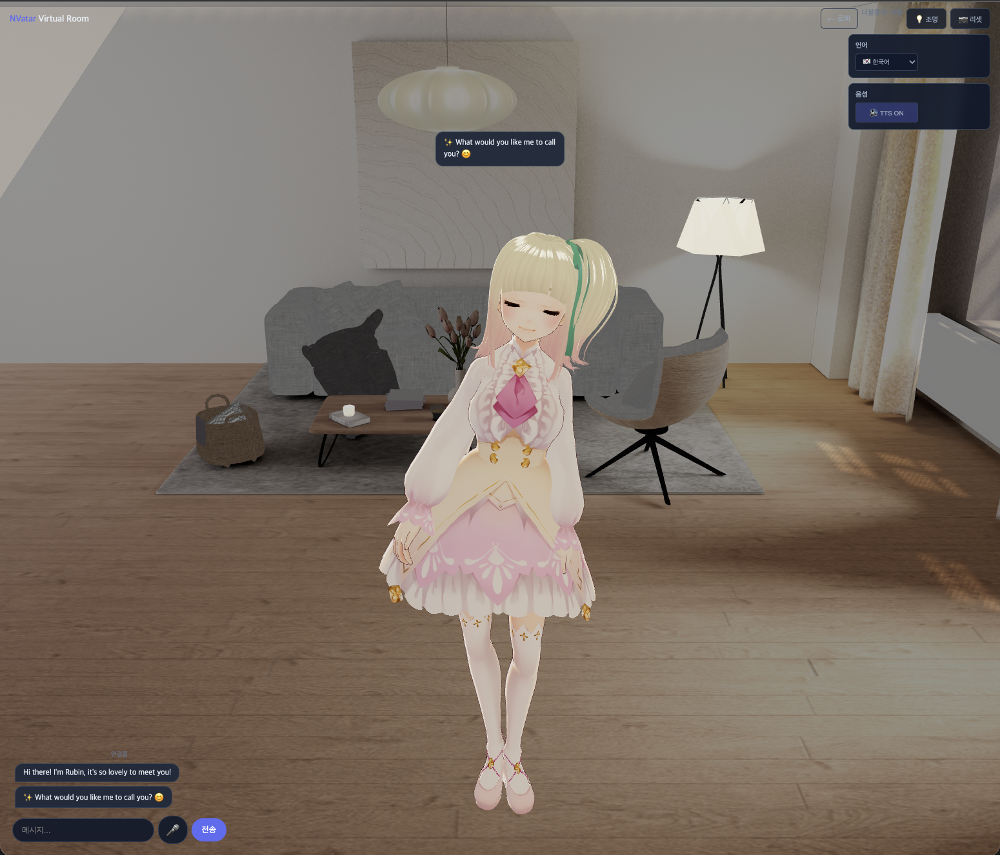
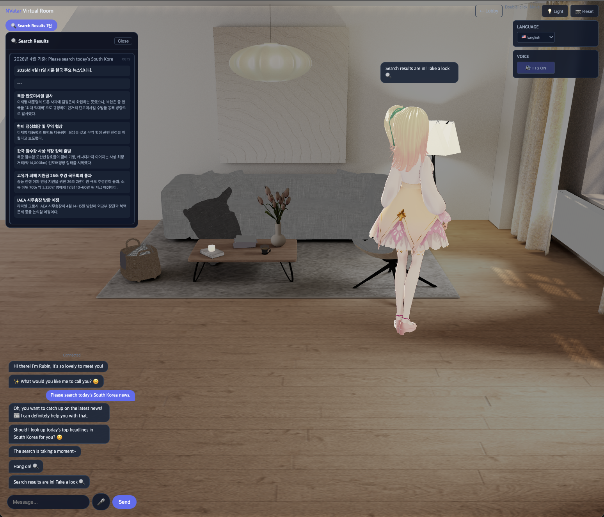
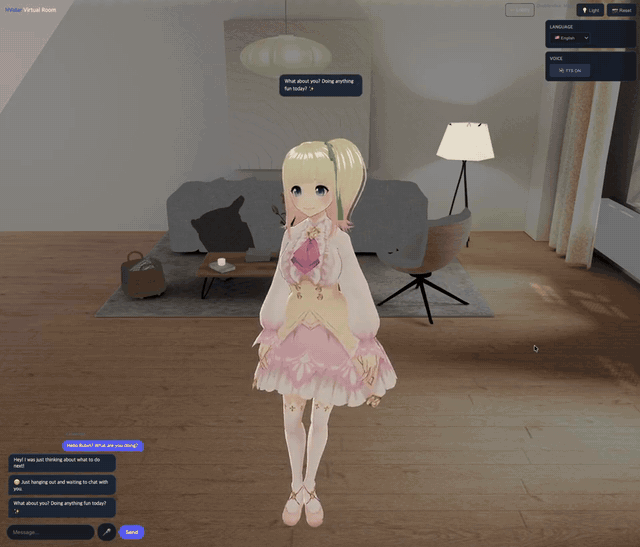

# NVatar — 記憶し、感じ、話すAIアバターの友達

[English](README.md) | [한국어](README.ko.md) | [中文](README.zh.md)

> 3Dバーチャルルームに住むAIの友達 — 音声出力、感情トラッキング、性格進化、多言語会話。

**[ライブデモ](https://nskit-io.github.io/nvatar-demo/)**（一時停止中）

> **お知らせ:** デモサーバーのメンテナンスのため、ライブデモは一時停止中です。ソースからは引き続き実行できます。

### スクリーンショット

| ロビー | ルーム |
|--------|--------|
|  |  |

| 検索結果 | チャットデモ |
|----------|-------------|
|  |  |

---

## NVatarの特徴

ほとんどのAIチャットボットはステートレスなテキスト生成器です。NVatarは**3Dルームに住むAIの友達** — 会話を記憶し、時間とともに性格が発展し、9次元の感情を追跡し、アバターの言語でクラウドTTSの音声を通して話します。

### ハイブリッドAIアーキテクチャ
**ローカル**と**クラウド**AIの長所を融合：
- **ローカルLLM**（Gemma 4 26B MoE、Apple Silicon）— 性格、会話、感情。高速でプライベート。
- **クラウド検索**（Claude WebSearch）— 事実の回答、リアルタイムデータ。必要な時だけ。

個人的な会話を外部サーバーに送ることなく、感情的な会話（ローカル）も今日の為替レート検索（クラウド）も可能です。

### 3層メモリシステム
アバターは単に応答するのではなく、**記憶**します：
- **L1（原本）** — 完全な会話履歴
- **L2（要約）** — 重要な瞬間を関連性スコアとともに圧縮
- **L3（キーワード）** — 長期記憶の断片: 関連性が下がった記憶がキーワードへと薄れ、アバターはそれを確信なく思い出します（「よく覚えていないけど…」）

100メッセージを超えると、L1が自動的にL2に圧縮され、関連性が下がったL2イベントは後にL3へ移ります — 人間が詳細よりも要点を覚えるように。（詳細: [chat-like-human-memory](https://github.com/nskit-io/chat-like-human-memory)）

### 9次元感情トラッキング
メッセージごとに9軸の感情状態が更新：
`喜び · 悲しみ · 怒り · 不安 · 愛情 · 興奮 · 退屈 · 信頼 · 好奇心`

感情は時間とともに自然に減衰し、高い感情は3Dアバターの表情やジェスチャーとして現れます。

### 性格進化
基本性格（フレンドリー、穏やか、ツンデレなど）＋ランダムMBTIからスタート。会話が蓄積されると、8つの性格特性 + MBTI 4次元が`pending_delta → decay → commit`サイクルで変化します。

### 音声出力（TTS）
> **現在の状態:** 設計上はアバターごとに固有の*クローン*音声を持ちます。依存していた外部クローニングサービスの契約が終了し、代替エンジンがプリビルト音声のクラウドTTSであるため、現在アバターは音声を**所有**するのではなく**選択**します。アバターごとのクローン音声は現在提供していません。

音声リストとデフォルト音声はアバターの言語に従います：
- 言語別速度自動調整（韓国語：0.85x、日本語：0.65x）
- テキスト前処理（絵文字除去、発音ガイド除去）
- キューベース順次再生＋入力時即座中断

### 自律的主体性 (Avatar OS)
アバターはステートマシンではなく — **自分で判断する主体性レイヤー** を持ちます。
- **軽量分類（プロトタイプ）**: 分類は小型モデルに委任; 26B モデルは実際の対話生成のみ。
- **Activity Density (T1~T4)**: アバターと多く話すほど生き生き、訪問を止めると徐々に休眠 — 長期アイドル段階は毎日ロジックベースの記憶 1 件を蓄積、**LLM コスト 0**。いつ戻っても即座に目覚める。
- **Rest = 記憶整理**: 休息状態 (マスター許可または自動アイドル) 進入時にアバターが自ら記憶を圧縮。状態フィールドが単なるラベルではなく実際の行動トリガー。
- **Source-agnostic 状態**: マスター命令、自己決定、UI イベントどこからでも — 単一コードパス、3 つの出所を別途追跡。
- **Trace 観測**: すべての判断がログされる。「なぜビビはあのとき返事しなかった?」のタイムラインクエリが可能。

プロトタイプとして構築し、長時間の内部ストレス実行で検証（ベンチマークではなく参考値）。

### ソーシャルエコシステム — 「人格は1つ、関係はたくさん」
多くのAIコンパニオンは1:1に閉じています。NVatarは**自分の他のアバターを同じ部屋に招待して、彼らが互いに関係を築くように**します。

- **人格はユーザーとの会話からのみ**形成 — アバター同士の対話は人格に影響しない
- **関係はペア別に記録** — 親密度・会話回数・最近の話題がペア別の関係ストアに蓄積
- **メモリトラック分離** — A↔Bの会話コンテキストはA↔ユーザーのコンテキストを汚染しない
- **Room Manager** — 中央スケジューラが発話タイミング、キュー、sticky target、auto-cascade(最大2ターン)を調整
- **文脈に合った口調** — ユーザーには設定した敬語レベル、アバター同士はタメ口
- **AFK安全** — タブ非表示で対話停止、1時間あたり最大6回キャップ(スクリーンセーバー用途にも対応)

「👥 友達」パネルで自分の別アバターを招待すると8秒以内に挨拶が交わされ、名前を呼べばチェーン会話が自然に展開します。

---

## 主な機能

| 機能 | 説明 |
|------|------|
| **3Dバーチャルルーム** | VRMアバター + Mixamo 33種アニメーション |
| **自然な会話** | Gemma 4 26B MoE + 性格・記憶・感情 |
| **音声出力** | クラウドTTS — プリビルト音声、言語別 |
| **音声入力** | Whisper STT — 自動言語検出 |
| **ウェブ検索** | リアルタイム事実検索 + 構造化結果 |
| **多言語** | KO、JA、EN、ZH — UIと会話 |
| **ソーシャルエコシステム** | 自分のアバター同士を会わせる — ペア別親密度、人格は独立 |
| **Room Manager** | 複数アバター対話の中央調整 — キュー / sticky / auto-cascade |
| **Room Authoring** | Edit モードでシーンのメッシュを複数選択 → グループ化 → DB 保存 |
| **Avatar OS** | 自律的主体性レイヤー（プロトタイプ）: 小型モデルに委任した分類、source-agnostic 状態、Activity Density 4-tier、rest 自動 compaction、trace 観測 |

---

## はじめ方

1. **[ライブデモ](https://nskit-io.github.io/nvatar-demo/)** を開く（一時停止中 — ソースからは引き続き実行できます）
2. **キャラクターモデル**選択 → **名前**入力 → **性格・言語**選択
3. **Create Avatar** → ルーム入場！

### ルーム操作

| 機能 | 使い方 |
|------|--------|
| チャット | 入力 → 送信（Enter） |
| 音声入力 | 🎤 → 録音 → 自動認識 → 自動送信 |
| アバター移動 | 床をダブルクリック |
| 言語変更 | サイドパネル（会話リセット） |
| TTS オン/オフ | サイドパネル 🔊 |
| 友達招待 | トップバー → 👥 友達 → 自分の別のアバターを [入場] |
| 特定の友達に呼びかけ | "ルビンちゃん、こんにちは" — 名前プレフィックスでルーティング |
| ルーム編集 | トップバー → ✏️ Edit → ギズモ移動 + ✍ Authoring パネル |
| パネル移動 | ヘッダーをドラッグ / ダブルクリックで折りたたみ |
| 検索結果 | バッジクリック → 閲覧 |

---

## 技術スタック

| レイヤー | 技術 |
|---------|------|
| **AIモデル** | Gemma 4 26B MoE (4-bit, Apple Silicon MLX) |
| **TTS** | クラウドTTS（プリビルト音声、言語別） |
| **STT** | Whisper large-v3 (MLX, ~500ms) |
| **3D** | Three.js + @pixiv/three-vrm + Mixamo FBX |
| **検索** | CSW — Claude WebSearch ハイブリッド |
| **バックエンド** | Python FastAPI + WebSocket |

---

## NSKitエコシステム

NVatarは**NSKit**フレームワークの一部です — AIネイティブ開発プラットフォーム。

| プロジェクト | 説明 |
|------------|------|
| **NVatar** | AIアバターチャット（このプロジェクト） |
| **NSKit Whisper** | STTサービス（Whisper） |
| **CSW** | Claude Subscription Worker — AI処理パイプライン |
| **NSKit Frontend** | セルフコンテインドUIフレームワーク |

---

## セルフホスティング

このデモクライアントは NVatar サーバーと通信します。公開デモサーバーはメンテナンスのため一時停止中です。クライアントが呼び出すサーバー API には独自の認証レイヤーがありません — 自前でインスタンスを運用する場合は前段に認証を置き、公開インターネットに直接さらさないでください。公開デモサーバーはデモ専用で、プロダクション用のエンドポイントではありません。連携する側は、呼び出し元が指定したアバターの所有者であることをサーバー側で確認し、CORS は自分の origin のみ許可してください(`*` は不可)。音声入力には別途 STT エンドポイントが必要です(例: `sdk-chat.html` に `?whisper=https://your-stt.example.com/api/v1/transcribe`、ルームでは `window.NVATAR_WHISPER_URL`)。NVatar インスタンスを自前で運用したい場合は[お問い合わせ](https://github.com/nskit-io)ください。

## サポート＆投資

NVatarは独立したR&Dプロジェクトです。価値があると思われたら：

- **Star** — より多くの人がNVatarを見つけられるように
- **投資 & スポンサーシップ** — nskit@nskit.io
- **投資のお問い合わせ** — パートナーシップや投資の議論を歓迎します

ビジネス、投資、セルフホスティングライセンスのお問い合わせ：

📧 **nskit@nskit.io**

## ライセンス

MIT — デモクライアントコードのみ。VRMモデルは個別ライセンス。MixamoアニメーションはAPI経由で提供。

## お問い合わせ

- GitHub: [@nskit-io](https://github.com/nskit-io)
- 制作: [Neoulsoft Inc.](https://neoulsoft.com)
